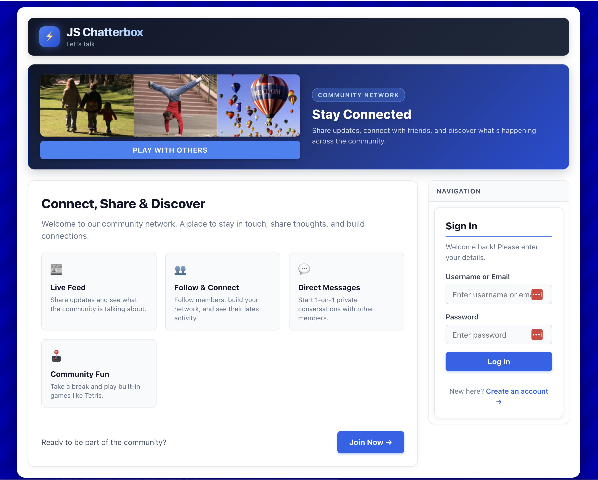
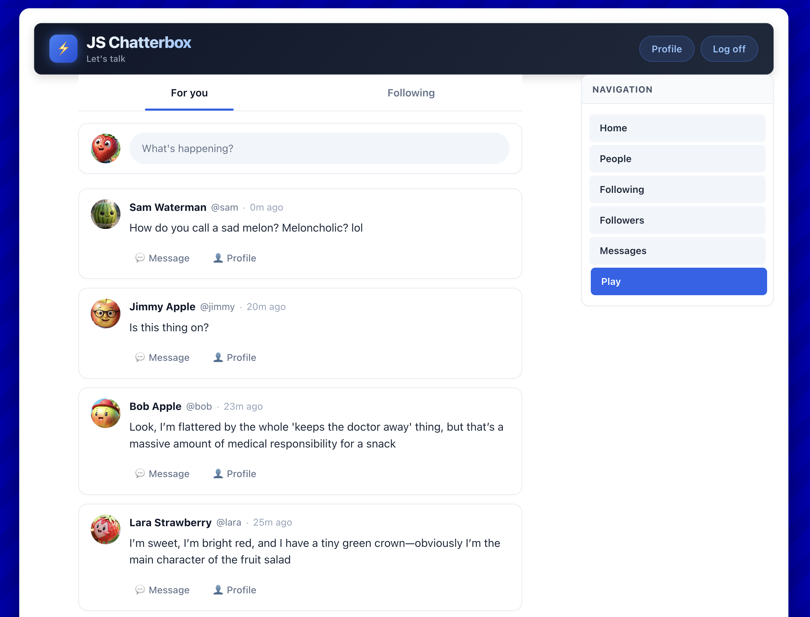
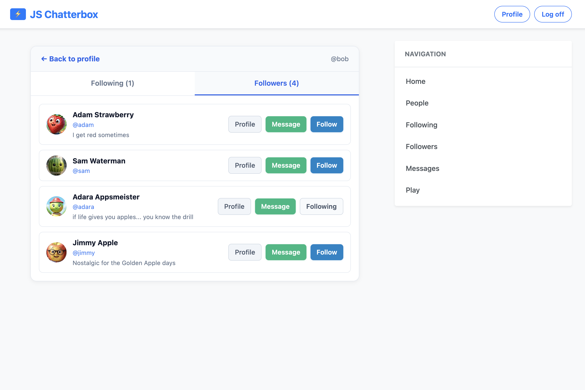

# Node Login Demo
-----------------
This is a Simple Password protected **demo** of a **node.js** password protected Member Zone.

This is by no means complete but should give you an idea to get started with form submission, validation, themes, mongoose mongo access, sessions and authentication

- If you have a single theme, you probably wanna use something like pug 

## Highlights:
- uses native node:http (no web framework)
- uses native node:sqlite (no database driver packages)
- has basic themes
- authenticates using sessions and sqlite
- supports profile pictures, stored as user media and selected per profile
- rudimentary theme engine (basic string replace)
- Shows how to create a simple member zone, storing the users in sqlite db. 
- features a buggy falling blocks game that is available if you are logged in to demonstrate a member only page

## To use:
- make sure node.js is installed and in your executable path
- database file (community.db) and tables are auto-created on startup
- run "node app.js" (or "npm start")

## Screenshots

## Files:
- **app.js** - main route and express setup
- **user.js** - mongoose mongo model and user abstraction class
- **routes.js** - kind of a controller class decides what pages to show/handles auth
- **res/** contains all graphics/ html pages
- **views/** contains views like login form, member text, welcome page...
- **themes/** those are themes that can be swapped for a different view
- **config/** - json config file
- **uploads/** - uploaded profile images (created automatically when needed)

Profile pictures can be uploaded from the profile edit page as PNG, JPEG, GIF,
or WebP files up to 5 MB. Each upload is recorded in the SQLite `media` table;
you can select any of your saved photos as the profile picture, and replacing
it does not remove older media.

## Licence

MIT License... Basically do whatever you want with it as long as you keep the license file

**Be cool, Redefine limits, have fun**
